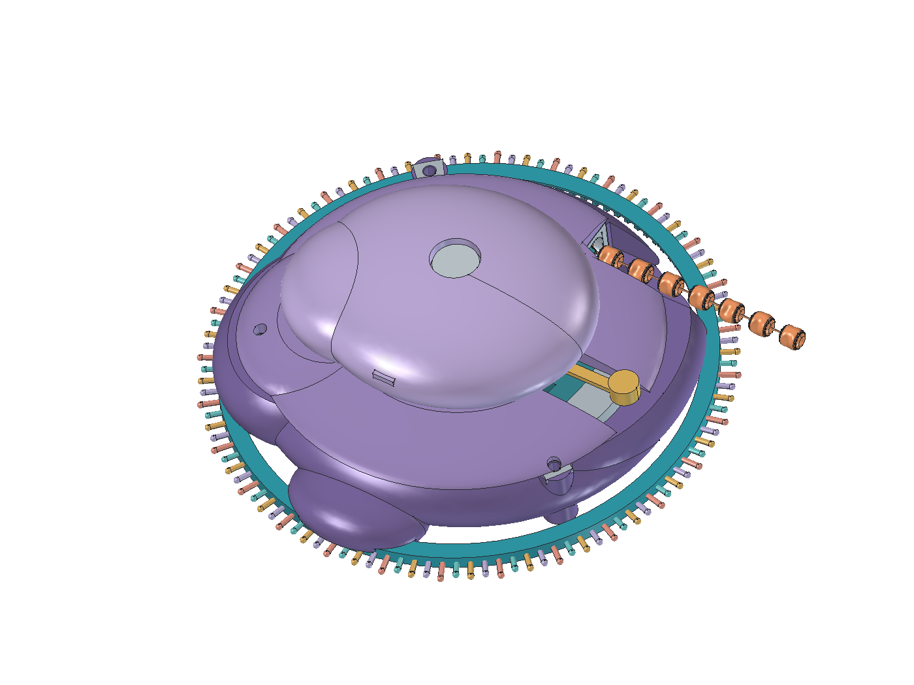

# mRNA toy

A handheld mechanical fidget inspired by protein translation. Move a closed RNA-like loop around the larger lower subunit, or rock the smaller upper subunit: three bases advance and one bead of a hidden protein chain emerges. Straighten the chain, release the clicker and reverse the RNA to return it.

**V5 is the current handheld design prototype.** Its direct bead-storage drum replaces the wrist cuff and tensioned rewind proposals. See the [V5 guide](cad/v5/README.md) and [focused report](cad/v5/checks.json) for the exact validation boundary. No physical or printing qualification is claimed. V4 and its separate print derivative are preserved.



Actual CAD; source and saved model define geometry. [Open mechanism](cad/v5/mechanism.png) · [Bead drum](cad/v5/drum.png). The [earlier AI illustration](docs/images/toy-concept.png) depicts a superseded wearable concept; see [image provenance](docs/images/README.md).

## Start here

- [Toy purpose and mechanics](docs/design.md)
- [Current state and engineering risks](docs/status.md)
- [Development commands](docs/development.md)
- [FreeCAD controls](cad/README.md)
- [Repository guidance](AGENTS.md)

## A1 mini print prototype

[Printing package and assembly guide](print/v4-a1-mini/README.md) | [V4 Print CAD and macro](cad/v4-print/README.md). This is a separate manufacturing derivative using TPU beads, thin copper wire, PETG and PLA. **Calibration and export review remain required; no physical print or assembly has been tested.** See [handoff status](print/v4-a1-mini/handoff.json). V4 is preserved.

## CAD versions

| Version | Files | Role |
| --- | --- | --- |
| **V5** | [Model](cad/v5/RibosomeV5.FCStd) · [Macro](cad/v5/RibosomeV5.FCMacro) · [Guide](cad/v5/README.md) | Current handheld: closed RNA loop, direct bead drum, upper clicker and reverse release. |
| **V4** | [Model](cad/v4/RibosomeV4.FCStd) · [Macro](cad/v4/RibosomeV4.FCMacro) · [Guide](cad/v4/README.md) | Preserved cuff comparison: covered mechanism and projecting RNA bases. |
| **V3** | [Model](cad/v3/RibosomeV3.FCStd) · [Macro](cad/v3/RibosomeV3.FCMacro) · [Guide](cad/v3/README.md) | Preserved comparison: lobed beads and same-direction outlet; full validation incomplete. |
| **V2** | [Model](cad/v2/Ribosome.FCStd) · [Macro](cad/v2/Ribosome.FCMacro) · [Guide](cad/v2/README.md) | Preserved comparison with invalidated historical validation. |

Open the V5 model directly, or execute its macro through **Macro → Macros…**. **Click upper subunit** animates one bead step, **Open lower body** reveals the internals, and the slider covers 0–22 steps. **Return one bead** requires the release checkbox; the physical strand must first be straightened. **Reset view / home** is a CAD reset.

## Development

Python 3.10+ can check repository integrity without FreeCAD:

```sh
python scripts/check_repo.py
```

Geometry work requires FreeCAD with `Part` and bundled `fcgear`; the known local runtime is FreeCAD 1.1.4. With its command-line executable on PATH:

```sh
python scripts/cad.py doctor
python scripts/cad.py build --version 5
python scripts/cad.py validate --version 5
```

The launcher defaults to V5, accepts `--freecad PATH` or `FREECAD_CMD`, and writes to ignored `build/v5/`. Saved CAD and reports are protected from launcher overwrites. Use explicit versions for preserved comparisons.

## Current direction

V5 is handheld. A loosely routed closed RNA loop passes through a covered drive station in the larger lower subunit. A fixed-axis idler links it to the bead drum. The smaller upper subunit rocks to operate the same drive through a releaseable ratchet. A fixed keeper supports the single-layer bead handoff. Protein shaping remains manual.

Printer/process, flexible RNA manufacture, calibrated fits, bead fixation, wire life, spring/ratchet qualification, fasteners and reliable feeding remain unresolved. The existing A1 mini package applies to V4 Print, not V5. Cloud migration is deferred. V2, V3 and V4 remain explicit comparisons.
