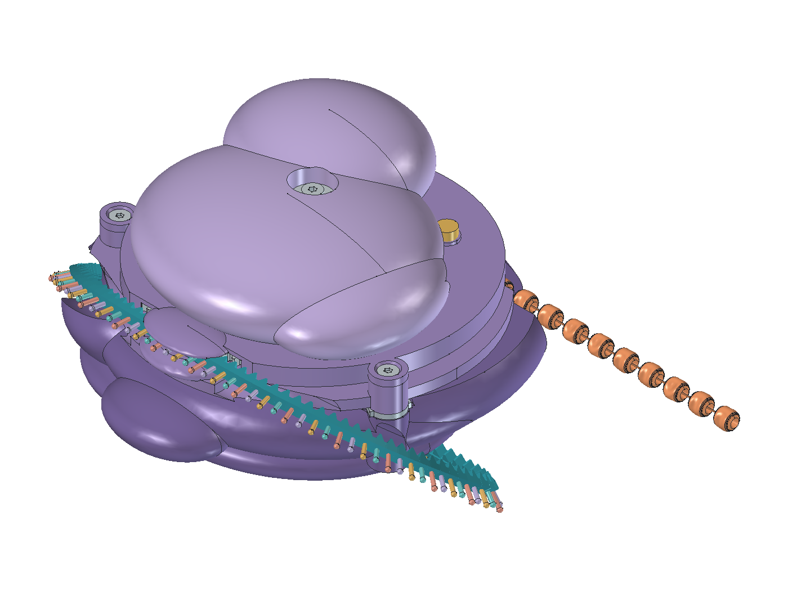

# mRNA toy

A handheld mechanical fidget inspired by protein translation. Move a captive RNA-like strand, or rock the upper subunit: three bases advance and one bead of a hidden protein chain emerges. Straighten the protein and move the RNA backward to retract it. Join the RNA ends underneath for a compact loop, or disconnect them for an open strand.

**V6 is the current handheld CAD prototype.** It has open-or-closed captive RNA, an external underside return, direct reversal without a release lever, and a cap input that disengages at rest. See the [V6 guide](cad/v6/README.md) and [focused report](cad/v6/checks.json) for the exact evidence boundary. Physical operation, click feel, clasp retention and printing remain unqualified. V5 and all older versions are preserved.

**V7 remains mechanically unfinished.** The follow-up repairs the keeper fit, upper-shell access and screw seats, rear lid column and upper-skin Boolean defects. The user stopped during integrated validation: the saved checkpoint is **INCOMPLETE_CONTINUATION**, with mechanical status **REVIEW**. It is not established as functional and does not replace V6's evidence. See the [V7 guide](cad/v7/README.md), [mechanical audit](cad/v7/engineering.md) and [continuation record](docs/v7-cloud-handoff.md). Work is on `codex/v7-forward-pickup`.



Actual CAD; source and saved model define geometry. [Side route](cad/v6/side.png) · [Open strand](cad/v6/open.png) · [External underside return](cad/v6/underside.png) · [Mechanism](cad/v6/mechanism.png) · [Cap input](cad/v6/cap-input.png). The [earlier AI illustration](docs/images/toy-concept.png) depicts a superseded wearable concept; see [image provenance](docs/images/README.md).

V6 retains the fuller asymmetric upper subunit introduced in the
[V5 proportion pass](docs/v5-proportions.md). Both outer RNA holders are now
removed: the strand leaves a short central capture channel, crosses the curved
side and returns through a shallow groove beneath the flatter palm dome. The
longer closed route keeps the drive entry, mechanism and clasp geometry.
The [fastening and assembly review](docs/v6-assembly.md) covers the aligned
screws, supported spindle and two keyed rotor parts. Its exact flexible outline
is secondary to handling and compact guidance.

## Start here

- [Toy purpose and mechanics](docs/design.md)
- [Current state and engineering risks](docs/status.md)
- [Development commands](docs/development.md)
- [FreeCAD controls](cad/README.md)
- [Repository guidance](AGENTS.md)

## A1 mini print prototype

[Printing package and assembly guide](print/v4-a1-mini/README.md) | [V4 Print CAD and macro](cad/v4-print/README.md). This is a separate manufacturing derivative using TPU beads, thin copper wire, PETG and PLA. **Calibration and export review remain required; no physical print or assembly has been tested.** See [handoff status](print/v4-a1-mini/handoff.json). V4 is preserved.

## CAD versions

| Version | Files | Role |
| --- | --- | --- |
| **V7 review** | [Model](cad/v7/RibosomeV7.FCStd) · [Macro](cad/v7/RibosomeV7.FCMacro) · [Guide](cad/v7/README.md) | Unfinished forward-pickup candidate; cloud CAD evidence and explicit mechanical failures. |
| **V6** | [Model](cad/v6/RibosomeV6.FCStd) · [Macro](cad/v6/RibosomeV6.FCMacro) · [Guide](cad/v6/README.md) | Current: captive open/closed RNA, external underside return, direct reverse and idle-disengaged upper input. |
| **V5** | [Model](cad/v5/RibosomeV5.FCStd) · [Macro](cad/v5/RibosomeV5.FCMacro) · [Guide](cad/v5/README.md) | Preserved handheld comparison: circular RNA, direct bead drum and external reverse release. |
| **V4** | [Model](cad/v4/RibosomeV4.FCStd) · [Macro](cad/v4/RibosomeV4.FCMacro) · [Guide](cad/v4/README.md) | Preserved cuff comparison: covered mechanism and projecting RNA bases. |
| **V3** | [Model](cad/v3/RibosomeV3.FCStd) · [Macro](cad/v3/RibosomeV3.FCMacro) · [Guide](cad/v3/README.md) | Preserved comparison: lobed beads and same-direction outlet; full validation incomplete. |
| **V2** | [Model](cad/v2/Ribosome.FCStd) · [Macro](cad/v2/Ribosome.FCMacro) · [Guide](cad/v2/README.md) | Preserved comparison with invalidated historical validation. |

Open the V6 model directly, or execute its macro through **Macro → Macros…**.
The RNA slider works in both directions, **Rock upper subunit** animates one
bead step, and **Clasp joined** selects the external loop or captive open
tails. **Open mechanism** reveals the internals. Straighten the physical
protein before reversing. **Home** resets the CAD study.

## Development

Python 3.10+ can check repository integrity without FreeCAD:

```sh
python scripts/check_repo.py
```

Geometry work requires FreeCAD with `Part` and bundled `fcgear`; the known local runtime is FreeCAD 1.1.4. With its command-line executable on PATH:

```sh
python scripts/cad.py doctor
python scripts/cad.py build --version 6
python scripts/cad.py validate --version 6
```

The launcher defaults to V6, accepts `--freecad PATH` or `FREECAD_CMD`, and writes to ignored `build/v6/`. Saved CAD and reports are protected from launcher overwrites. Use explicit versions for preserved comparisons.

## Current direction

V6 is intended for two-handed use. One TPU-candidate strip can be joined with
a reusable underside clasp or left open. Its clasp shoulders and captured
guide throats retain it in either mode. A straight rack engages the bead
drum's gear directly. RNA reverses without an extra control. The upper input
uses an internal lift cam and a separate symmetric click detent. Protein
shaping remains manual.

Printer/process, TPU pitch stability, clasp retention, calibrated fits, bead
fixation, wire life, spring/pawl/detent behavior, fasteners and reliable feeding
remain unresolved. The existing A1 mini package applies to V4 Print. V5 and
older versions remain explicit comparisons. GitHub/cloud continuation of V7
is now authorized; see its repository handoff for runtime and evidence limits.
