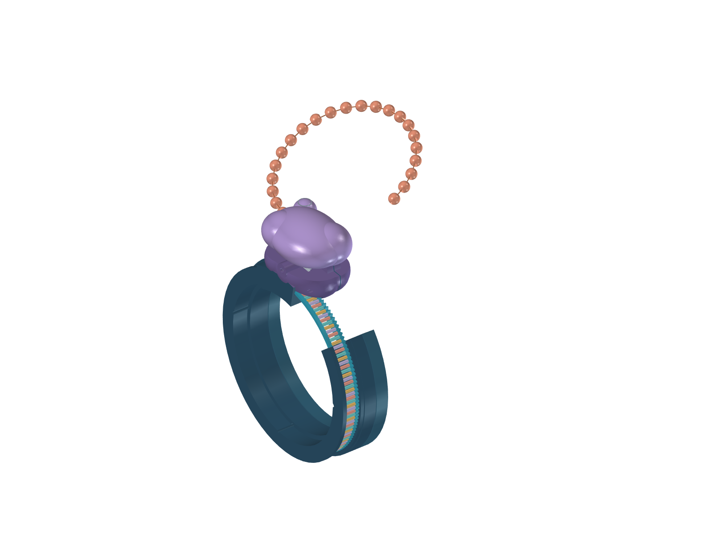
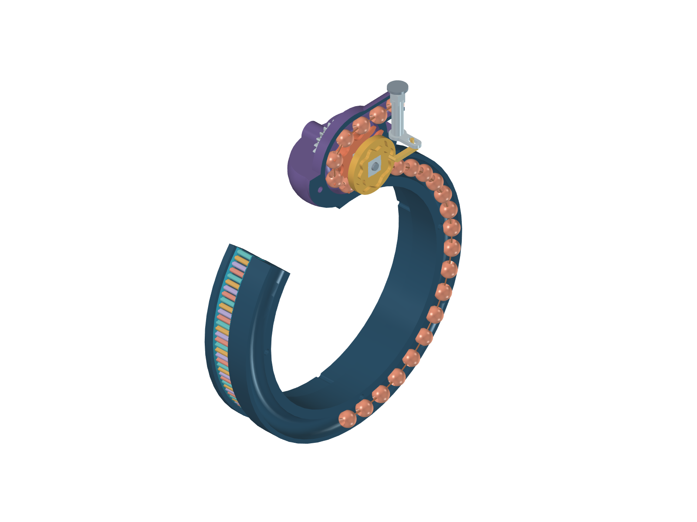

# mRNA toy V2

**Preserved comparison.** A later audit found bead-to-feeder interference that the original profile-only check missed. The historical `checks.json` does not establish reliable actual bead phasing. V3 includes checks against the assembled bead positions and uses the direct outlet instead. V2 geometry is retained unchanged for comparison.

A plastic C-shaped cuff carries a separate RNA-like C dial. Their openings align at home so they can flex together for wearing. The ribosome is fixed to one cuff end; it does not rigidly bridge the opening. A hidden channel stores a strand of 26 plain beads on a thin poseable wire core.

Turning the RNA drives a concealed pinion and an eight-pocket bead wheel on one shaft. The protein turns around the wheel inside the ribosome and emerges above it, parallel to the RNA but travelling the other way. Reverse the dial after manually straightening the emerged strand. The proposed copper core, bead fixation and curved storage must be tested physically before printing a complete wearable.

The gearing gives **three RNA bases per bead**, one click and one swivel cycle. Three bases form a codon; ordinary sense codons specify one amino acid, while stop codons terminate translation. The toy repeats the mechanical ratio rather than simulating sequence recognition.

Open **Ribosome.FCMacro** in FreeCAD for the controls. The RNA slider runs from home to 165°. **One codon** animates a 7.5° turn; **Home** straightens the display and resets the dial. Up to 22 bead steps / 132 mm emerge; four beads remain hidden for continued engagement. “Open storage / mechanism” removes the rear case and upper lobe and makes the front case transparent. “Pose emerged protein” displays an illustrative bend; clear it before reversing. In the saved FCStd, the same controls are available under **Motion → DialDegrees / PoseProtein**. Native expressions work after reopening without running Python.

The upper lobe swivels about an axis pointing away from the wrist. An eight-cycle closed groove in the shaft cam moves a captured follower and guided slider. A vertical pin in a radial slotted lever rotates the keyed swivel post. The slot accommodates the pin’s changing distance from the pivot, and the groove drives both directions. The fixed inner guide keeps the RNA and protein paths aligned during swivel.

The cuff case splits through the storage channel for assembly. The RNA’s concealed inner rail contains an arcuate stop groove; a fixed pin limits travel in both directions. The nominal cuff bore is 59 mm, the C opening is 40°, bead diameter is 4.4 mm, and bead channel diameter is 5.3 mm. These are proposed starting dimensions, not a wrist fitting or manufacturing specification. The cuff and RNA arc require flex-capable plastic; a rigid PLA cuff is not assumed. The small axle, wire and final fasteners may be metal.

`bracelet.py` builds the current model. `checks.json` records the actual geometric checks and their limits. Motion is prescribed; CAD does not establish friction, wire buckling, fatigue, click feel or safe fit. This is an engineering prototype for review and bench development, not a qualified print release.
