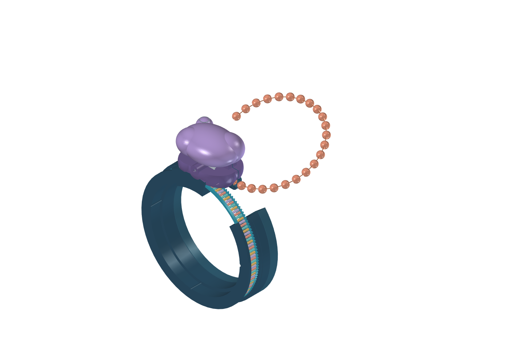

# mRNA toy V3 — direct protein feed

V3 has a fixed ribosome on a plastic C cuff and a separate RNA-like C dial. The dial and cuff openings align at home. The concealed bead chain follows the wrist curvature into a short tangent outlet: **the protein and RNA now move in the same local direction**. The tight half-turn inside V2 is removed.

The bead feeder has a new trajectory-generated pocket profile. A 4.9 mm keeper channel closely supports the 4.4 mm beads at the feed station, with a rounded transition from the wider 5.3 mm storage channel. The case splits through the channel so the strand and guide can be assembled. Beads must remain fixed at 6 mm pitch on the proposed thin copper core.

The ratio remains **three RNA bases per bead**, with one nominal click and one swivel cycle per bead. A 7.5° RNA turn advances 6 mm of protein. Maximum travel is 165° / 132 mm: 22 beads emerge and four remain hidden. The upper lobe swivels approximately ±5.95° about an outward wrist axis through the independently routed groove cam, guided follower, slotted lever and keyed post.

## Watch it move

Run **RibosomeV3.FCMacro** through FreeCAD's Macro dialog. Use **Home**, drag the **0–165° slider**, or press **One codon** to animate a bead step. The panel reports the swivel angle. Use **Open storage / mechanism** to inspect the drive. **Pose emerged protein** illustrates a user-shaped strand; clear it before reversing.

For exact static poses, open **RibosomeV3.FCStd**, select the **V3 controls — turn RNA…** item in the tree (the **Motion** object), and edit **DialDegrees** in the **Data** tab. At 1.875° and 5.625° the lobe reaches its two swivel extremes. At every 7.5° whole bead step it returns to neutral. The saved model contains native motion expressions, so the macro is not required to change positions.

`bracelet_v3.py` is the geometry source. `validation_v3.py` writes the current results to `checks.json`, including actual bead-to-wheel alignment checks. The cuff and RNA arc need flex-capable plastic; a rigid PLA cuff is not assumed. The small axle, core and fasteners may be metal. Colours and dimensions are proposals.

This is a geometric engineering prototype, not a print release. Reliable bidirectional handoff with the reduced bead wrap, feed torque, wire buckling and fatigue, detent life, cuff opening and final fasteners still need bench development. The posed strand is illustrative; gravity and elastic deformation are not simulated.
