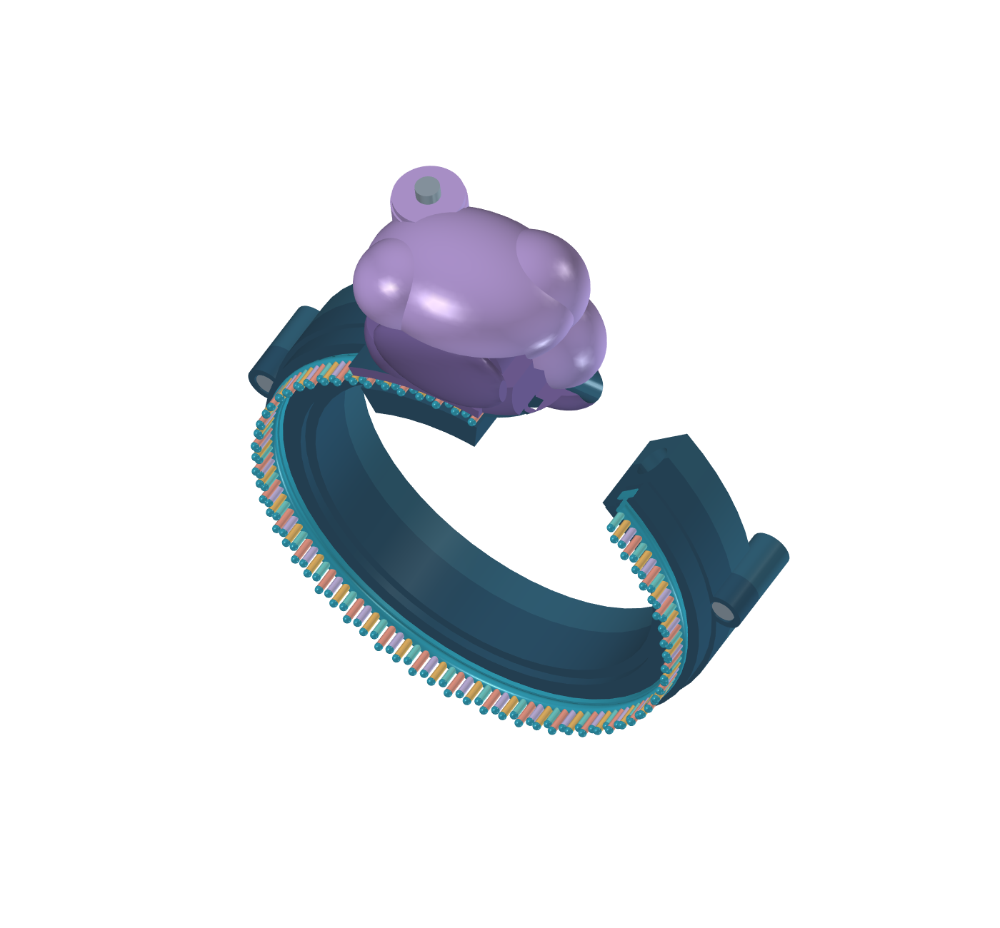

# V4 Print - Bambu Lab A1 mini prototype

Separate manufacturing derivative of V4 for the standard 0.4 mm nozzle, PETG, PLA and an external TPU spool. V4 is preserved in `../v4/`. No physical print, assembly, feeding, strength or wear test has been performed.

Open [RibosomeV4Print.FCStd](RibosomeV4Print.FCStd) directly. For movement controls, execute **RibosomeV4Print.FCMacro** through **Macro > Macros...** from this folder. Opening a macro as text does not execute it. Native expressions retain 0-165 degree dial travel, three RNA bases per bead step, the shallow same-direction outlet and manual chain shaping.



The [printing and assembly guide](../../print/v4-a1-mini/README.md) contains the parts, material plates, calibration order and hardware list. Start with the calibration plates.

## Manufacturing changes

- Three TPU bead variants stay within the 4.4 mm bound at 6 mm pitch. A small flat sole supports vertical-bore printing. The candidate bore is 0.6 mm for 0.25 mm annealed copper wire. Test beads include 0.4, 0.5, 0.6 and 0.8 mm bores. Nozzle diameter does not guarantee a matching printed bore.
- Both bead ends have 2 mm counterbores for recessed metal stops. The folded crimp envelope must remain within 1.5 mm diameter. Grip on solid copper and stretching the bead over a stop remain physical tests.
- Two keyed feeder halves print flat. Their fork gap and swept pocket profile accommodate stops and axial play.
- Hidden channel diameter is 5.6 mm, with a 5.2 mm keeper. RNA backbone is 1.8 mm, stems at least 1.2 mm, and root web 0.8 mm.
- Replaceable PETG click leaf has 0.6, 0.8 and 1.0 mm test variants. Metal axle and travel stop, M2 fasteners, a side-loaded swivel nut and a TPU axle plug provide serviceable retention.
- A short feeder fixture, fit gauge and 6 mm pitch jig are supplied.

## Check boundary

[checks.json](checks.json) records focused solid and motion checks, including actual bead/crimp/feeder phases. [Slicer checks](../../print/v4-a1-mini/slicer-checks.json) record offline Bambu Studio results. Neither establishes physical operation; V3's full baseline validation remains incomplete. Sub-micron BREP tolerance healing and saved-file reopening are checked separately.

## Reproduce

```sh
python scripts/check_repo.py
python scripts/cad.py build --version 4-print --force
python scripts/cad.py validate --version 4-print
```

Run `export_print.main()` in FreeCAD's Python runtime to export a generated model. `scripts/print_package.py` flattens installed official Bambu profiles, authors plates and slices offline. See [development commands](../../docs/development.md). Source, CAD, exports and reports must be promoted together. The launcher protects saved version files.
