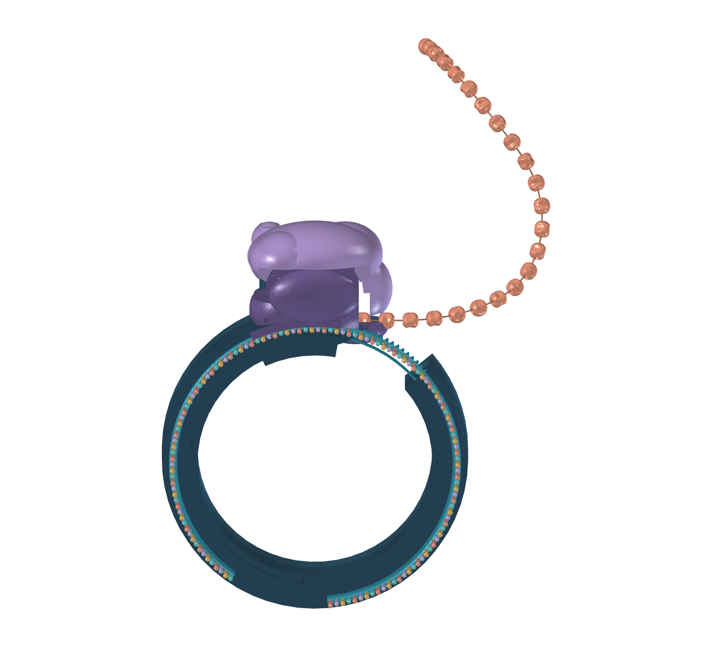

# mRNA toy V4 — exposed RNA strand and covered mechanism

V4 is a copy of V3 with three coordinated changes: a rounded fixed cover conceals the front drive mechanism, the cuff rim is recessed beside the RNA, and one rounded RNA backbone carries free-ended projecting bases. The concealed gear rail, stop groove, protein feeder and native motion coupling are retained.

The same-direction protein exit, compact lobed beads, three bases per bead, 165-degree travel, 132 mm feed, four retained beads and manual protein shaping remain. The C-cuff opening is not rigidly bridged. This is a geometric prototype, not a print-qualified or physically tested toy.

## Open and use

Open **RibosomeV4.FCStd** for the saved CAD view. To operate the controls, use **Macro → Macros…**, set User Macros Location to this folder, select **RibosomeV4.FCMacro**, and click **Execute**. The macro selects its adjacent V4 file and does not edit V3.

Use **Home**, the **0–165 degree slider**, or **One codon**. Each 7.5-degree step advances three RNA bases and one protein bead. **Example hand-shaped chain** is illustrative; straighten before reversing. **Open storage / mechanism** reveals the internal route.



[RNA and recessed cuff](rna.png) · [Covered mechanism](mechanism.png) · [Protein outlet](outlet.png) · [Unchanged bead family](beads.png)

## Geometry and check scope

`bracelet_v4.py` is self-contained. Its normal build revises the four changed shapes in this folder's copied model, retaining the other mechanism components and expressions. `build_from_scratch()` remains available for complete procedural regeneration.

`validation_v4.py` checks revised solid validity, all-angle RNA envelopes, the protein route, gear mesh phases, cover/lobe movement, actual saved bead-to-feeder phases, travel stops and native positions. The cover clearance uses a conservative box enclosing its complete relative swivel range. Finger access dimensions describe nominal geometry, not a successful usability test.

These focused V4 checks do not complete V3's unfinished full validation. See [checks.json](checks.json) and [project status](../../docs/status.md). Physical grip, dial retention, cuff flex, reliable feeding, strength, fits and wear still need development. Manufacturing preparation remains analysis only.

## Development

From the repository root:

```sh
python scripts/check_repo.py
python scripts/cad.py build --version 4
python scripts/cad.py validate --version 4
```

Outputs go to ignored `build/v4/`. Present and save the generated model in the FreeCAD GUI before promoting it, so direct opening retains visibility and colours. V3 remains preserved in its own folder, including its incomplete-validation report.
