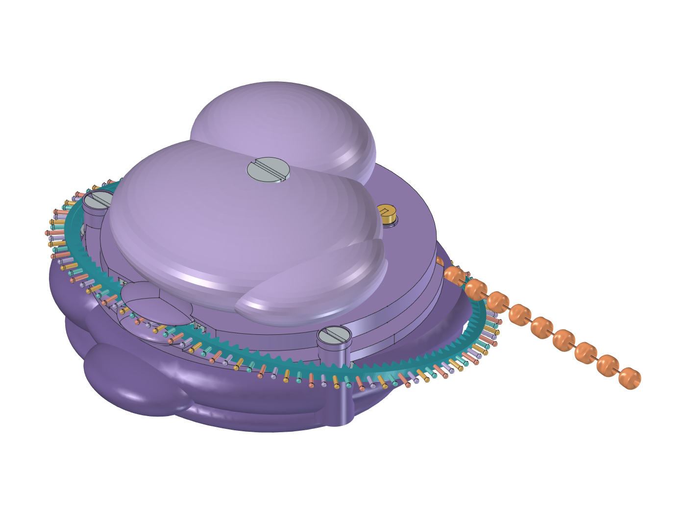

# V6 updated print — printed fastening derivative

Separate manufacturing candidate on `version6-updated`. The sources and saved
CAD in `cad/v6-updated/`, V6 and V7 remain preserved. Select
`--version 6-updated-print` explicitly; the launcher default remains V6.

Open [RibosomeV6UpdatedPrint.FCStd](RibosomeV6UpdatedPrint.FCStd), or run the
adjacent [macro](RibosomeV6UpdatedPrint.FCMacro). In the saved document,
`Motion.BeadSteps`, `Motion.CapStroke`, `Motion.CapReturning` and
`Motion.StrandClosed` control the native poses. The default saved view is
the closed RNA route with eleven beads fed and the upper at rest.



[Stock spring contacts](stock-springs.png) ·
[Printed fasteners](printed-fasteners.png) ·
[Mechanism](mechanism.png) · [Underside](underside.png)

This derivative keeps the 13.2-degree clasped RNA route, the bead drum and
direct reversal. It adds:

- Three 4 mm printed screws with a 1.2 mm coarse pitch and recessed slotted
  heads. These are modelled threads, rather than M2 size envelopes.
- Three replaceable keyed printed nuts, inserted through the underside.
  They stop against shoulders lower in the posts, preserving material near
  the travelling RNA groove. Hold a nut in place while starting its screw.
- A 6 mm coarse threaded spindle extension and a closed printed retaining
  cap. The cap's internal roof stops on the fixed spindle, leaving a nominal
  0.25 mm axial gap above the moving upper. Its flange is integral, so there
  is no separate retaining washer.
- Integral PETG spring supports and a rounded contact boss on the pawl.
  No separate metal spring washers are needed. Two selected stock torsion
  springs replace the illustrative torsion/compression pair.
- A wider 0.8 mm neck above the existing 1 mm cam-contact ball. The contact
  ball, cam law and drive timing are retained.

PETG Translucent is the functional rigid-part and fastener candidate. TPU 90A
remains the RNA/bead candidate; PLA Matte can be used for rigid fit trials.
All three exact Bambu presets support the user's A1 mini / 0.4 mm nozzle.

## Evidence and remaining work

The saved [CAD report](checks.json) is **FOCUSED_PASS**, with mechanical
status **REVIEW**. It retains the complete sweep and the focused follow-up
for a 0.3 mm cup-wall trim. The follow-up compares all other local shapes,
placements, Motion values and native expressions, proves material-only
removal with an unchanged connected root, and repeats affected clearances
and spring checks. [GUI evidence](gui-checks.json) matches this native file.
The [A1 mini guide](../../print/v6-updated-a1-mini/README.md) records the 20
checked exports and the sliced nine-piece PETG fit plate.

The thread fits require physical coupons. The CAD audit checks both clearance
at the installed phase and blocking under attempted axial pullout, plus
rotation with pitch-matched translation. Extended OCCT checks apply to the
new fastener solids. These checks do not establish printed thread strength,
fit, clamp load, wear or fatigue.

Two standard Allegro springs are selected: **TECH-AR MS/095P TYP2** returns
the cap, and **MS/095L TYP1** biases the pawl. See [the hardware BOM and force
paths](engineering.md) for direct links, trimming, preload and the evidence
boundary. Coil bodies are conservative annular envelopes with explicit legs;
native helix centrelines remain hidden inspection references. The V6 feeding
and reverse action remain, with a horizontal bias spring instead of the
hard-to-source compression candidate.


Printing a closed mesh does not establish dependable assembly or feeding.
The leaf, spring forces, bead/wire retention and the RNA manufacturing layout
still need physical qualification. This is a CAD candidate, not a full print
release or a final Bambu print job.

```powershell
python scripts/cad.py build --version 6-updated-print --force --freecad 'C:\Program Files\FreeCAD 1.1\bin\freecadcmd.exe'
python scripts/cad.py validate --version 6-updated-print --freecad 'C:\Program Files\FreeCAD 1.1\bin\freecadcmd.exe'
python scripts/check_repo.py
```

Builds and diagnostic exports belong in `build/v6-updated-print/`. Promote
saved model, GUI presentation and reports together after checking them.
The adjacent macro opens this derivative rather than the preserved baseline.
