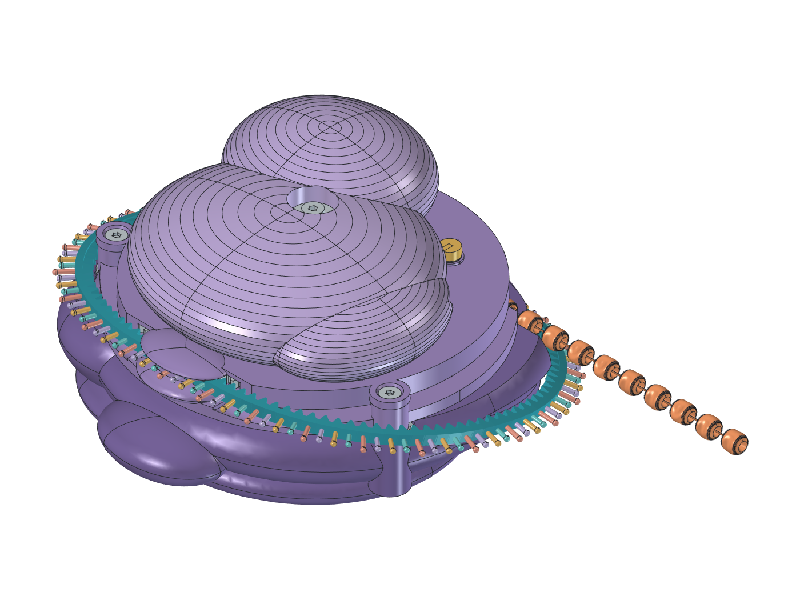

# V6 updated — V6 mechanism, V7 RNA traversal

Separate candidate on `version6-updated`, branched from `version7` at `7be0579`.
V6 and V7 source, models, reports and images are preserved. The launcher still
defaults to V6. This candidate uses V6's 6° entry cam and single driving pawl;
it does not include V7's unfinished forward-pickup coupling or trip/reset.

[Model](RibosomeV6Updated.FCStd) · [Controls](RibosomeV6Updated.FCMacro) ·
[Source](bracelet_v6_updated.py) · [Springs and leaf](springs_v6_updated.py) ·
[Checks](checks.json) · [GUI checks](gui-checks.json) · [Engineering](engineering.md)



[Side route](side.png) · [Open RNA](open.png) · [Underside](underside.png) ·
[Mechanism](mechanism.png) · [Spring installation](spring-installation.png) ·
[Springs under cap load](spring-loaded.png) · [Torsion spring and cup](torsion-spring.png) ·
[Serpentine leaf](serpentine-leaf.png)

The clasped route uses V7's 13.2° inclined plane, 33 mm bends and 110 pitch
positions: 248.814 mm nominal strip length, with the same 149.288 mm feed
travel. It crosses the body and closes around the far flank, alongside a
3.4 mm groove. The narrower bead cavity, keeper pocket and front screw columns
preserve the housing material and travelling-rack clearance. Open strand mode,
three RNA bases per bead, 26 beads, 28 pockets, 22 steps and four retained beads
remain the V6 contract.

## Where the spring forces go

The metal **torsion return spring** surrounds the upper's central hub. Its
lower radial terminal belongs to the fixed cover; its upper terminal belongs
to the rocking upper. The fixed cup has a bottom seat, an inner mandrel and
an outer wall, with a bridge back to the cover post. Rocking the upper clockwise
adds winding. The upper terminal then pushes the upper back counterclockwise.
The proposed installed preload is 22°. This spring returns the upper only.
The shared bead drum stays at its new index while the rigid input pawl rises
over its return ramps. Backward RNA still directly retracts protein.

The **compression spring** sits around the pawl guide pin. Its upper washer
bears against the underside of the upper's carrier; its lower washer bears
on the sliding pawl. The spring pushes the pawl down. At rest the fixed cam
lifts the pawl 2 mm clear of the track, compressing this spring. As the upper
enters its feed stroke, the cam lets the pawl descend. Face ramps lift it
again during return. Both washers and the changing coil height are modelled.

The **printed detent** is one serpentine part with seven transverse webs and
six rounded U bends, inspired only by the circled folded leaves in the
[user's reference](../../docs/images/v6-updated-flexure-reference.png).
Its fixed root joins the cover pedestal. The rounded inner follower moves
radially over the 28 symmetric notches, permitting both feed directions.
The web is 0.9 mm wide and 2 mm high, with 1 mm centre-radius U bends. Print
orientation, force and durability need qualification; a folded shape alone
does not establish that it is stronger or an adequate holding detent.

## Inspecting the model

Open the saved model directly. `Motion.BeadSteps` moves the RNA and protein;
`StrandClosed` selects the clasped or open layout; `CapStroke` shows upper
motion, torsion winding and compression of the pawl spring. Native expressions
and features work after reopening without running Python. The controls macro
adds V6's sliders and buttons. Spring sweeps make live recomputes slower than
the earlier space-claim model.

Use **Open mechanism**, or hide `UpperLobe`, `LowerLid` and `GearGuard` in the
tree. `ReturnSpringHousing` is the fixed cup; `CapReturnSpring` and the two
terminal features represent one metal spring. `PawlBiasSpring` and its two
seat washers represent the second metal spring. Construction wires and
flexure Boolean tools are hidden. The spring and leaf detail views use actual
CAD, not illustrations.

## Rebuild and evidence

```sh
python scripts/cad.py doctor --freecad PATH
python scripts/cad.py build --version 6-updated --force --freecad PATH
python scripts/cad.py validate --version 6-updated --freecad PATH
python scripts/check_repo.py
```

Generated artifacts go to `build/v6-updated/`. The copied V6 validation checks
real bead/drum and rack/gear contacts, both RNA modes, housing envelopes,
native ratios, cap entry/feed/return, captive guides, stops, seats and sampled
assembly. Additional checks cover connected folded-leaf poses, spring solids,
coil/cup clearance, terminal connections and compression-spring seats.

The saved report includes the full sweep plus targeted corrections to the
lower washer's installed-height expression, the detent pedestal's outer
lip and the torsion cup's upper-terminal window. The corrected washer is checked against every physical feature through
the full feed/return cycle. The pedestal relief retains its 2 mm radius root core;
the folded leaf, both springs and terminal travel are rechecked after it. The presentation
file is compared with the audited geometry before promotion.

Read the exact status in the report. Spring coils are geometric candidates;
end treatments and terminal bends remain schematic. Flexible poses are
prescribed, not an equilibrium solution. No physical operation, spring
selection, force, print fit, click sound, fatigue or hand fit is qualified.
