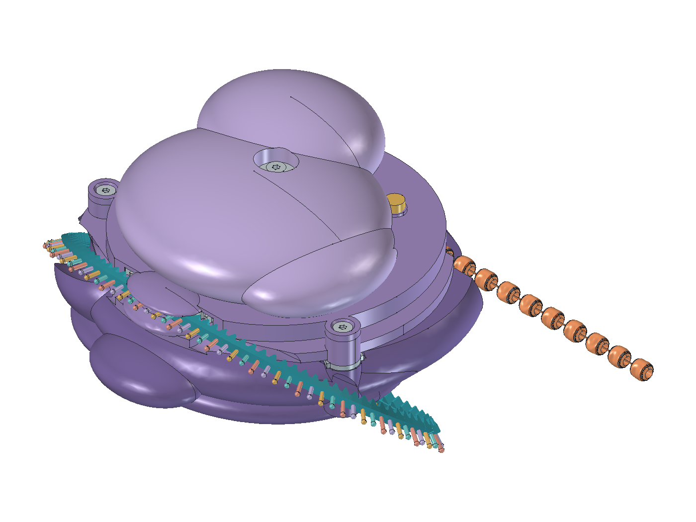

# V6 — captive open/closed mRNA

V6 implements the 2026-10-30 open-strand / underside-loop direction. V5 and
all older versions are preserved. This is a mechanical CAD prototype with
prescribed flexible poses; no physical or print qualification is claimed.

[Model](RibosomeV6.FCStd) · [Controls macro](RibosomeV6.FCMacro) ·
[Source](bracelet_v6.py) · [Route math](rna_path.py) · [Checks](checks.json) ·
[GUI checks](gui-checks.json)

[Starting force budget](engineering.md) separates the assumed spring/leaf
calculations from CAD clearance evidence and physical qualification.
[Fastening and assembly review](../../docs/v6-assembly.md) explains the corrected
screw stack, supported spindle, keyed rotor and insertion checks.



[Open strand](open.png) · [External underside return](underside.png) ·
[Side route](side.png) ·
[Mechanism](mechanism.png) · [Cap input](cap-input.png) · [Home](home.png)
[Housing screw section](fasteners.png) · [Spindle section](spindle.png)

[Six static inspection views](inspection/README.md) ·
[Download the six PNGs](inspection/V6-six-views.zip)

## Interaction

- Hold the fixed lower body in one hand. With the other hand, slide the RNA
  forward to expose protein or backward to retract it. Straighten the exposed
  protein before reversing. No release tab, rewind reel or take-up spring.
- Join the two RNA ends underneath for a compact loop, or separate them for
  an open strand. Both ends stay captive in the short central channel. The
  clasp halves have shoulders too large to pass through its capture throat.
- The return is external in a shallow groove in the flatter palm dome.
  There are no bottom rails, underside cover or parking clip. In loop mode the clasp
  travels with the strip; it is centered below the toy at mid-travel and near
  one side at each endpoint.
- Rock the upper subunit for one forward feed step. An internal cam lifts
  its driving pawl clear at rest. A separate symmetric detent supplies the
  proposed bidirectional click. There is no permanent holding pawl.
- A travel slot integral with the fixed lower shell bounds both directions.
  At full extension, the cap's
  driving face meets the stopped feed wheel after its initial engagement
  motion. There is no designed empty-click mode. Strength and resistance to
  pawl skipping under overload require physical testing.

The strand is preassembled: 26 connected beads, 22 available feed steps and
132 mm maximum protein feed. Four beads remain inside, at least three at or
behind the tangent station. Each step advances three RNA bases.

## How the two inputs share the drive

The retained 28-pocket bead drum carries one 84-tooth spur gear at the upper
plane. The straight RNA rack meshes directly with it. Module 0.72 gives a
2.26195 mm tooth/base pitch; three teeth move 6.78584 mm per bead step. RNA
forward travel is leftward across the front while protein emerges rightward
from the retained tangent outlet.

The closed nominal RNA route has a 226.195 mm pitch-line length and 84 mm
overall width. Its straight drive span remains 18 mm. Broad 33 mm shoulder
bends leave that central peak at a shallower 38-degree inclination, crossing
the curved flank before 10 mm lower bends carry the return beneath the dome.
The underside return lies about 8.5 mm farther toward the rear than before,
with a similar bottom height. The strip is 22.619 mm longer. Both outer holders
are removed. The rounded central mesh keeper
retains the strip and controls its engagement. The lid shoulders are relieved
around the actual path. Maximum RNA travel remains 149.288 mm; the clasp stays
outside the central channel throughout the stroke.

There are 100 nominal pitch positions, including the connector region, and
97 visible bases. Bases and teeth retain the same pitch through the working
engagement span. The clasp never needs to pass through the drive.

The groove follows the new side-and-underside route; the drive, fastening and
clasp geometry are retained. The flatter palm dome is retained. Comfortable
handling and compact guidance take priority over an exact loop outline. These
are prescribed flexible poses, not an elastic or hand-fit simulation.

Three aligned countersunk housing screws clamp the keeper/lid/cover stack.
The internal lid is a 2.2 mm plate with analytic elliptical edges and integral
screw columns; it replaces the thin spline skin that gave unreliable Boolean
sections. The lower body's integral spindle supports a separate washer, with
0.15 mm nominal endplay for the moving cap. The cover's click root is integral.
The rotor has two D-keyed parts so the keeper, lid and cover can be inserted
in sequence. See the assembly review for nominal hardware and its test limits.

The upper input has 6 degrees of entry motion followed by one 12.857-degree
feed stroke. A spherical follower runs on a fixed conjugate lift cam. The pawl
is axially clear at rest, descends for feed, and rises over axial face ramps
on return. A small bias spring and cap-return spring are reserved as labelled
space claims; neither returns the protein. The detent has 28 symmetric
notches, one per bead step, and permits RNA movement in either direction.

## Native motion and controls

Open the saved model directly; its expressions work without executing Python
or a macro. Select `Motion` and edit:

| Property | Purpose |
| --- | --- |
| `BeadSteps`, 0–22 | Direct RNA feed/retraction, including fractional inspection poses. |
| `StrandClosed` | Joined external return or separate captive tails. |
| `CapStroke`, 0–1 | Entry followed by one forward feed step, bounded at maximum feed. |
| `CapReturning` | Animation bookkeeping after committing a forward step; not a user-operated reverse release. |

The macro adds the RNA slider, **Rock upper subunit**, **RNA backward — one
bead**, **Home**, clasp mode and cutaway controls. Releasing the RNA slider
settles it at a click index. Start a complete cap stroke from an indexed
position. During a cap cycle the forward half advances `EffectiveSteps`; the
return half holds that result while the cap returns clear.

Changing `StrandClosed` selects two nominal layouts of the same material
length. It does not simulate a hand opening the clasp or the free tails
falling under gravity. RNA cell rotation axes and positions are saved native
expressions so the strip follows the inclined return after normal reopening.

## Evidence boundary

The [report](checks.json) records the actual solid results and exact status.
It covers real RNA rack/gear phases in both modes, real bead/drum handoff,
continuous drive and protein envelopes, the external RNA envelope, captured
guide and end-stop witnesses, actual travelling shoulder cells/bases against
the cover and lid, both continuous closed-loop and open-tail body envelopes,
actual travelling-clasp clearance, native
positions and orientations, direct reversal with the cap disengaged,
cap feed/return, follower clearance and positive travel stops.

The TPU backbone is represented by overlapping connected cells, and the click
leaf by connected rectangular chords. These are kinematic descriptions of
single flexible parts, not separately manufactured links or an elasticity
solution. They do not prove longitudinal stretch, tooth stability, click
force or sound, grip comfort, clasp snap retention, spring selection or life.
The button joint is a candidate peel-release snap, with no rigid overlap in
its seated pose; assembly deformation and retention force remain untested.

V6 needs a physical RNA/guide/clasp sample, then the cap/detent and bead drum
under representative loads. Firm TPU is the RNA starting direction; grade,
printing process, pitch stability and fatigue are undecided. The RNA is
installed with the guide cover removed, then captured by the assembled
cover. This is not an A1 mini manufacturing release; that package remains a
separate V4 Print derivative.

## Rebuild

```sh
python scripts/cad.py doctor --freecad PATH
python scripts/cad.py build --version 6 --force --freecad PATH
python scripts/cad.py validate --version 6 --freecad PATH
python scripts/check_repo.py
```

The launcher defaults to V6 and protects saved version artifacts. Generated
outputs go to `build/v6/`. Present in the FreeCAD GUI, save and normally reopen,
capture the views, then validate the promoted saved model before promoting
the report. See [development](../../docs/development.md).
`presentation_v6.run(model_path, output_dir)` in a FreeCAD GUI macro performs
the controls and normal-reopen checks and writes the nine views into a build
folder. It refuses to write into any saved `cad/` version directory.
