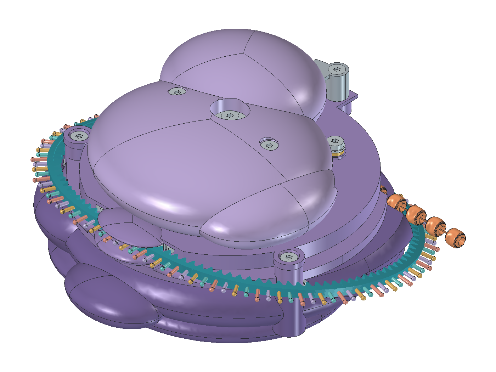

# V7 — CAD review candidate

**Status: INCOMPLETE_CONTINUATION. The requested functional mechanism is still unfinished.**
The source build and native GUI acceptance completed; cloud access was lost during
the integrated validation. Saved geometry, views and GUI evidence match. No
completed integrated or functional PASS is claimed.
This continues `codex/v7-forward-pickup` from `fa32f91`. V6 and all earlier
version files remain preserved; V6 is still the launcher default.

[Continuation record](../../docs/v7-cloud-handoff.md) ·
[Saved CAD](RibosomeV7.FCStd) · [Controls macro](RibosomeV7.FCMacro) ·
[Executed checks](checks.json) · [GUI evidence](gui-checks.json) ·
[Mechanical audit and force assumptions](engineering.md)



[Far-flank route](side.png) · [Underside](underside.png) · [Open strand](open.png) ·
[Mechanism](mechanism.png) · [Pickup](pickup.png) · [Return](return.png)

## What changed

- The manual pawl guide now lies between the two toothed tracks. Its bridge
  crosses above the pickup teeth; its pin starts above the pickup base plate.
- Carrier spokes no longer fill the spindle and retainer passages. The fork's
  full guide bore is reopened after its arm is fused to the collar.
- The fork arm and latch lip are separated from the reset follower, with a
  finite bearing under the raised tab. These corrections do not actuate the latch.
- The dedicated symmetric detent is a separate, radially installed leaf below
  the pickup track. An M2 x 3 screw and 0.5 mm washer clamp its seated root.
  Its proposed section is 12 x 1.3 x 1.0 mm; material and fatigue remain unqualified.
- The RNA route is inclined 13.2 degrees, with 33 mm bends, 110 pitches and
  248.814 mm material length. Its return centre is approximately
  y=35.118, z=3.904 mm, farther across the midline and higher on the far flank.
  The groove radius is 3.4 mm. A separate continuous envelope bounds the
  outward-facing bases; their full circumcircle is no longer carved inward.
  A 30.9 mm storage cavity leaves material behind the revised groove.

The two 22-pitch end reserves preserve the original rack phase at the unchanged
front entry. The lid columns retain their 3.1 mm bearing seats while the
unused outer margin is removed for rack clearance.

The front rack entry, 149.288 mm RNA travel, 28-pocket drum, 26 beads,
22 available steps, four hidden beads and three bases per bead are retained.
Manual input retains 3 degrees of entry plus 12.857 degrees of positive drive;
RNA pickup rocks through 12.857 degrees. The strokes are intentionally unequal.

## Mechanical blockers

The independent audit prevents a geometry/animation result from being
reported as a functional PASS:

1. The proposed return spring supplies about 4.28 N·mm at home. The revised
   manual pawl's entry cam alone needs about 6.26 N·mm without friction;
   latch reset and bearing loads are additional.
2. The trip's buckling/snap branch, energy and latch release remain prescribed.
   Its animated centreline changes length; this is not an elastic solution.
3. Continuous RNA pull has no physical gate during return/reset. Holding RNA
   still in the CAD cycle does not impose that constraint in hardware.
4. Before the end trip, pickup B can block partial upper return after A's entry
   clearance is recovered. With B engaged, returning the upper while holding
   the drum fixed is a contradictory contact constraint. Stronger springs alone
   do not fix it. Arbitrary partial-stroke and reverse transitions remain open.

`checks.json` records actual rigid overlaps, contact witnesses, assembly results,
native errors and the mechanical audit. A `REVIEW` result is a failed or
unestablished check, not a qualified mechanism. Read the exact remaining
collision and assembly failures in that report; the corrections above do not
imply that every integrated check passed.

## Inspecting and reproducing

Open the saved model directly or run the adjacent macro. `Motion.InputKind`
selects RNA forward (0), upper input (1), or RNA reverse (2). `CyclePosition`
runs a prescribed feed/trip/return study; `BeadSteps` sets its starting index.
The saved expressions are self-contained. Native motion and working GUI
controls establish CAD behavior, not automatic mechanical operation.

```sh
python scripts/check_repo.py
python scripts/cad.py doctor --freecad /path/to/compatible/FreeCADCmd
python scripts/cad.py build --version 7 --force --freecad /path/to/compatible/FreeCADCmd
python scripts/cad.py validate --version 7 --freecad /path/to/compatible/FreeCADCmd
```

FreeCAD 1.1.4 with `Part` and bundled `fcgear` was exercised in the cloud.
Generated work belongs in `build/v7/`. `build()` also defaults there; saved
artifacts are promoted deliberately. Exact rational ellipsoid patches and analytic
cylinder/torus route sections replace problematic generic spline Boolean inputs.
The original representation passed basic validity but failed extended BOP checks
and produced incorrect intersections. Structural solids now receive extended
checks; exact patch boundaries are retained without final seam simplification.

No physical prototype, force measurement, feeding/retraction qualification,
spring selection, fatigue, acoustic, clasp retention or print qualification is
established. The V4 Print package does not qualify V7.
