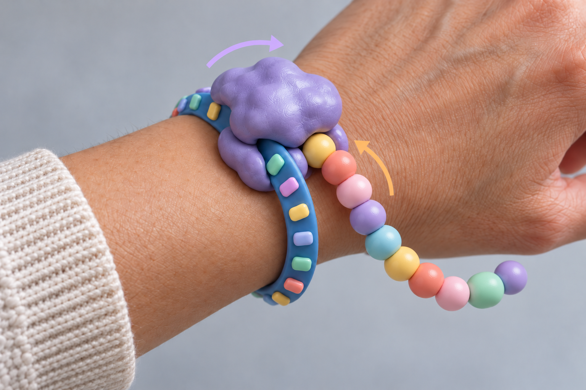

# Current concept — mRNA toy V3

An attractive wearable translation toy: a fixed ribosome on a nearly closed plastic C cuff, a separate RNA-like C dial, and plain amino-acid beads emerging from the ribosome. The waiting beads are hidden in a channel around the cuff. Their thin wire core lets the user shape the emerged protein, then manually straighten it for retraction.

At home, the two C openings align for wearing. Dialling the RNA moves its arc across the cuff opening and drives the bead feeder. The ribosome is attached to one cuff end so it does not rigidly join both ends. The visible protein exits parallel to the RNA, in the same local direction, through a short outlet with a close bead keeper. One upper lobe swivels while the inner feed paths remain fixed. The swivel does not require the protein to wrap around its shaft.

The preferred ratio is three RNA bases per bead. Bounded dial travel retains a short engaged tail so the strand can reverse. No incoming protein beads should be visible in the normal assembled view.

The current editable model, FreeCAD macro, operating guide and geometric checks are in [../cad/v3/](../cad/v3/README.md). V2 is preserved separately in `../cad/v2/` for comparison. Dimensions, tolerances, material choice and fasteners are proposed engineering choices. Physical tests must establish cuff flexibility, reliable reverse feed, wire life and click feel.

The original reference shows the intended wearable character, not the V2 storage or drive layout:

