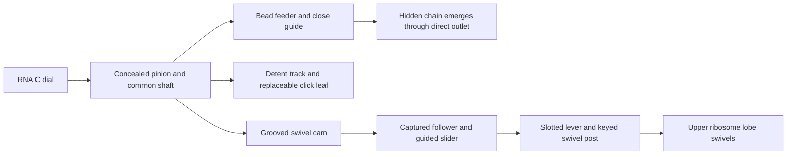
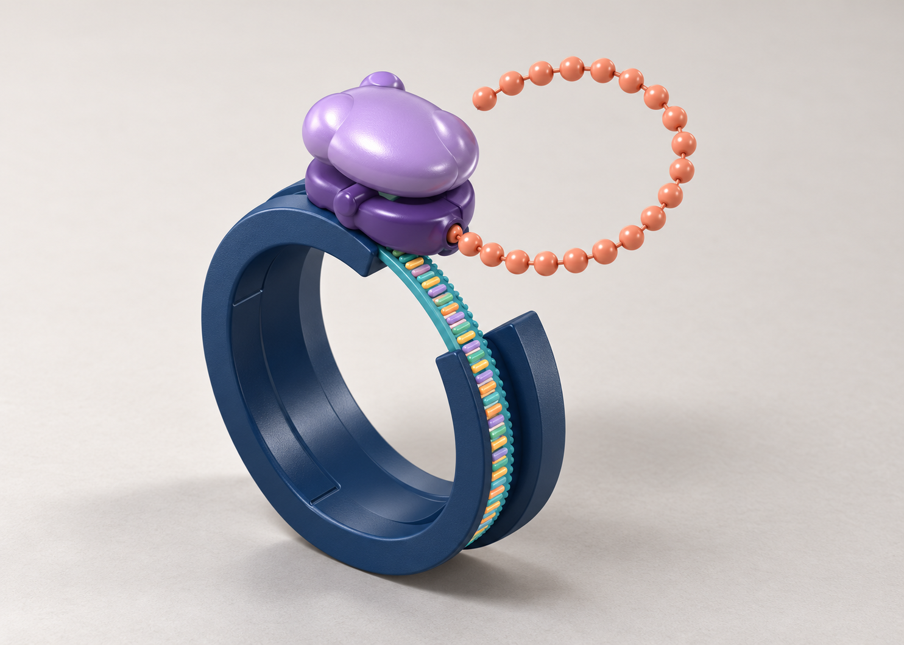

# Purpose and conceptual mechanics

## The experience

The toy should be an attractive wearable fidget that makes translation tangible: moving an RNA-like strand through a ribosome reveals a growing, shapeable protein chain. A deliberate click and a small swivel provide tactile and visual feedback. The exposed protein should become part of the bracelet's sculptural appearance.

The chain already exists inside the cuff. This is a reversible mechanical analogy, not a simulation that joins individual amino acids or recognises a real RNA sequence. Three RNA bases form a codon; sense codons specify amino acids, while stop codons terminate translation. The toy uses the three-to-one rhythm without implementing stop-codon logic. Manually posing the chain illustrates folding without modelling molecular forces.

## Current interaction

1. Return the dial home. The openings in the C cuff and RNA arc align, allowing the proposed flexible plastic arcs to spread together for wearing.
2. Turn the RNA dial. Its arc moves around the cuff and across the stationary opening. The ribosome stays mounted to one cuff end.
3. A preassembled bead chain emerges from its hidden store through a short outlet. Protein and RNA move in the same local direction at the ribosome.
4. Shape the exposed wire-core chain by hand. Straighten it before reversing the dial to return it to storage.
5. Mechanical stops retain an engaged tail. The ribosome does not travel around the wrist.

## How the motion is coupled

The lower housing keeps the RNA and protein guides stationary. The upper lobe turns about an axis pointing away from the wrist. A pin in a radial lever slot accommodates the difference between the slider's straight motion and the lever's rotation. A closed cam groove drives the follower in both directions.

The protein follows the gentle wrist curve into a tangent outlet. It does not need to turn around the swivel or make the tight internal half-turn used in V2. A close keeper is proposed to maintain bead engagement with the reduced wrap around the feeder.

The case splits through the storage channel for assembly. A fixed pin runs in a concealed arcuate groove in the RNA rail; its closed ends limit dial travel.

## V3's proposed proportions

| Relationship | Current value |
| --- | --- |
| RNA bases per bead step | 3 |
| RNA dial travel per step | 7.5 degrees |
| Protein feed per step | 6 mm |
| Maximum dial travel | 165 degrees |
| Maximum protein feed | 132 mm / 22 bead steps |
| Total / retained beads | 26 / 4 |
| Upper-lobe swivel | About ±5.95 degrees; one cycle per step |
| Cuff bore / nominal opening | 59 mm / 40 degrees |
| Bead / storage / keeper diameter | 4.4 / 5.3 / 4.9 mm |
| Proposed copper core | 0.36 mm diameter |

These are engineering starting points, not manufacturing tolerances, a confirmed wrist fit, or a validated material specification. Most parts are intended to be plastic; the core, axle and final small hardware may be metal. The cuff and RNA arc need flex-capable material. No rigid-PLA cuff assumption has been validated.

## Visual direction

The ribosome should retain an organic, asymmetric two-lobe silhouette. RNA and protein should be visually distinct. The latest bead discussion favours compact asymmetric, molecular-looking contours with consistent feed geometry; those shapes are not yet implemented. Colours are provisional and a Moderna-inspired palette was discussed as a later aesthetic direction.

The early on-wrist, single-band illustration is **superseded**. The concept has evolved to a separate structural C cuff and moving RNA dial, a fixed ribosome, concealed waiting beads and a direct same-direction protein outlet. Do not use the early image as a target for those relationships.

The illustration below was regenerated from the [current V3 CAD view](../cad/v3/bracelet.png) to reflect that evolution. It is **AI concept art**, not an exact CAD render or a manufacturing specification. Its rounded bead placeholders do not implement the proposed molecular-looking bead redesign. Geometry and tolerances remain defined by the V3 model and source.

See [image provenance and the generation prompt](images/README.md).
