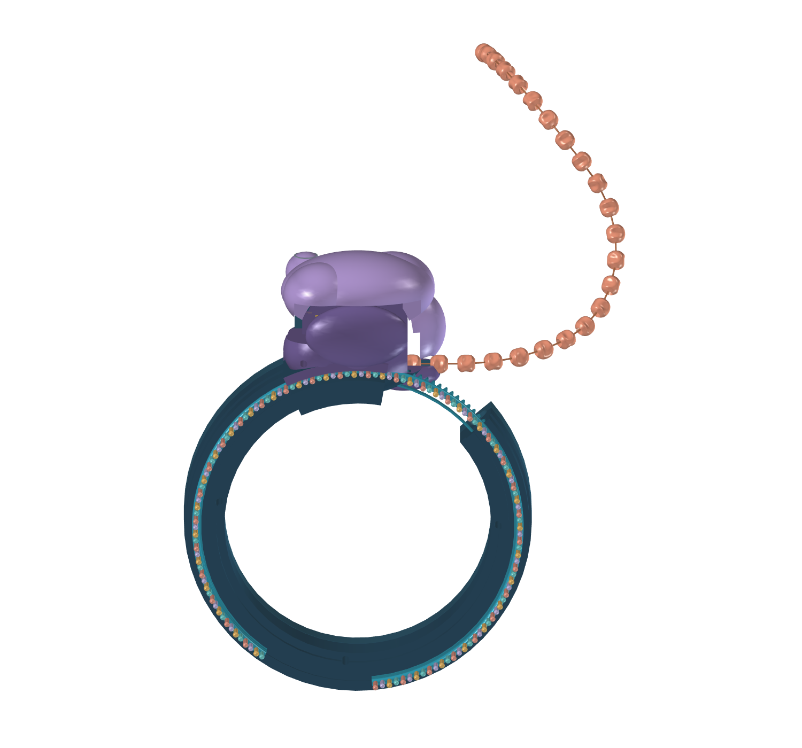

# Purpose and conceptual mechanics

## V6 updated print candidate

The separate [print derivative](../cad/v6-updated-print/README.md) preserves
V6 mechanics and the updated clasped route. It replaces bought fasteners
with coarse printed screws, keyed nuts and a stopped spindle cap. A stock
right-hand torsion spring in a fixed rear-left cup returns the upper; a
stock left-hand torsion spring mounted horizontally in the upper presses
the pawl downward. Integral seats and explicit wire legs show both force
paths. Their conservative coil envelopes are nonprinted hardware parts.
See the [stock BOM and fit trials](../print/v6-updated-a1-mini/README.md).
Spring rates, folded-leaf holding force and physical operation need testing.

## V6 updated candidate

The user chose V6's single-pawl mechanism with V7's clasped far-flank RNA
traversal on `version6-updated`, branched from `version7`. The separate
[candidate](../cad/v6-updated/README.md) adds explicit torsion and compression
spring parts, their mounting/seat geometry, and a folded serpentine printed
detent inspired by the user's photo. It retains V6's 6° manual entry and
direct RNA reverse. It does not adopt V7's unfinished pickup/trip/reset.
Spring motion and leaf deflection are prescribed geometry; forces and physical
operation remain unqualified.

## V7 development candidate

V7 is separate from V6 and remains unfinished. Its intended two-pawl coupling
adds forward RNA pickup of the upper, with an end-trip and hold-open reset,
while retaining upper-driven forward feed, direct reverse with the upper home
and the dedicated bidirectional detent. Its RNA should cross farther over the
body midline and close along the far flank in a matching groove. The current
13.2-degree / broad-bend layout has a 3.4 mm rail/clasp groove and a separate
continuous base envelope. Its force and automatic release/reset design remains
under review; see the [mechanical audit](../cad/v7/engineering.md).

See [V7 guide](../cad/v7/README.md) and [cloud handoff](v7-cloud-handoff.md) for
the source, proposed timing, incomplete checks and the user's routing sketch.
The saved V7 model is not evidence of a functional physical release/reset.

## Current V6 captive open/closed RNA

V6 implements the user's 2026-10-30 direction: a single TPU-candidate RNA strip
passes along the front cleft between the two subunits. Its ends can be joined
underneath for a compact loop, or separated for an open strand. The underside
return sits externally in a shallow groove in the flatter palm dome.
There is no parking clip. Enlarged clasp shoulders cannot pass through the
central capture throat, so the open strand stays threaded.

Both outer RNA holders are removed. Only the rounded central capture channel
at the drive peak remains. Broad shoulder bends cross the curved flank at a
38-degree inclination, then pass underneath through the open groove. The longer
closed route retains the entry and mechanism. The lower dome remains
flat, without bottom rails. The exact flexible outline is secondary to
comfortable handling, smooth movement and compact guidance.

The fastening audit corrected obstructed screw paths, a floating spindle and
an unsupported retainer seat. One aligned three-screw stack now clamps the
keeper, analytic elliptical lid plate and cover. The spindle is integral with
the lower body and supports a separate retaining washer. Two keyed rotor parts
and a larger concealed cover opening permit insertion in sequence. See the
[assembly review](v6-assembly.md) for actual-solid witnesses and test boundaries.

Moving RNA backward directly reverses the same bead drum. No external release,
cord reel, take-up spring or automatic protein winding is used. A symmetric
detent provides the proposed click in either direction. The upper subunit
retains one-step feed input through a cam-lifted pawl that is clear at rest;
its force, reliable return and resistance to overload remain physical-test
questions.

The 28-pocket drum, 26 beads, 6 mm protein pitch, 22 available steps and four
retained beads are preserved. Three RNA teeth/bases advance per bead. An
84-tooth gear on the common carrier meshes directly with the straight rack.
The joined RNA path has a 226.195 mm pitch-line length and 149.288 mm travel.
The clasp moves underneath as the strip travels, and remains clear of the
central channel across the intended range. Shared drum stops and the cap drive faces
provide the proposed endpoint from either input.

Read the [V6 guide](../cad/v6/README.md), [current CAD](../cad/v6/handheld.png),
[open strand](../cad/v6/open.png), [underside](../cad/v6/underside.png) and
[checks](../cad/v6/checks.json). Flexible cell/leaf poses are prescribed CAD,
not elasticity or force simulation. This is not a qualified print release.

## Preserved V5 handheld comparison

The object is a palm-held ribosome. The larger lower subunit contains a captive
single-row bead drum; a smaller upper subunit rocks under the thumb. A separate
closed RNA loop runs outside most of the lower body and enters a covered front
cheek for positive engagement. It is no longer a wrist cuff or a finger ring.

The 2026-10-30 proportion pass gives the upper shell a fuller asymmetric
head/body/platform silhouette and adds a fixed underside palm swell. The
intended two-hand use cups the fixed lower body from below while the other
hand operates the upper shell or RNA. The RNA remains closed for this pass;
its final route is being reconsidered. See the [proportion review](v5-proportions.md)
for ribosome references, clearance corrections and physical hand-fit limits.

Move the RNA, or click the upper subunit: both operate one shared drive. Each
complete step advances three RNA bases and exposes one bead. The RNA is a
single visible backbone with free-ended coloured bases and hidden drive teeth.
Its nominal circular CAD path is a flexible-loop layout, not a claim that the
material can stretch or sag without affecting engagement.

The 28-pocket drum directly locates the beads between two relieved fork lanes.
A stationary outer keeper and top roof prevent lift-out. A short tangent guide
supports the handoff into the shallow cleft. There are 26 connected lobed beads,
with a 4.4 mm bound and nominal 6 mm path pitch. Full travel is 22 steps / 132 mm;
four beads remain inside, at least three of them at or behind the tangent
station. The additional drum positions leave a transfer gap. The drum's pitch
diameter is about 53.5 mm; that is not the entire lower-body or toy size.

The RNA has 112 bases and inward drive teeth. A fixed-axis 14-tooth idler links
the RNA to an 84-tooth sun on the drum's rigid carrier. Three RNA teeth therefore
advance one drum pocket. Both inputs necessarily move RNA and protein together.

The upper rocker carries a flexible driving pawl. A separate holding leaf keeps
the indexed position while the rocker returns. A lift-to-release yoke raises
both leaves on guide posts for reverse. Their unloaded CAD geometry and an
upper-return-spring space claim are preliminary engineering, not a qualified
ratchet or measured spring design.

To retract, straighten the exposed protein, lift the release tab and reverse
the RNA. The driven drum captures beads into its existing seats; nothing winds
onto a take-up cord or spring spool. A moving pin in a closed arcuate slot limits
both ends of travel. There is no automatic folding or curling. The hidden chain
already exists; this is a reversible analogy, not loose-amino-acid assembly or
sequence recognition.

See the [V5 guide](../cad/v5/README.md), [actual CAD](../cad/v5/handheld.png),
[open mechanism](../cad/v5/mechanism.png) and [drum](../cad/v5/drum.png).
Actual bead-to-drum phases, gears, solid clearances, stops and saved native motion
are checked separately from physical feeding, elasticity, force and fatigue.

## Preserved V4 cuff comparison

The remaining sections document V4. Its CAD, reports and V4 Print/A1 mini package
remain preserved; they do not describe the new handheld mechanism.

## The experience

The toy is an attractive wearable fidget that makes translation tangible: moving an RNA-like strand through a fixed ribosome reveals a growing, shapeable protein chain. A click and a small driven swivel give tactile and visual feedback. The exposed protein becomes part of the bracelet's sculptural appearance.

The chain already exists inside the cuff. This is a reversible mechanical analogy, not a simulation that joins amino acids or recognises an RNA sequence. It retains the three-bases-to-one-bead rhythm without stop-codon logic. Hand shaping illustrates folding without modelling molecular forces.

## Interaction and coupling

1. Return the dial home. The C-cuff and RNA openings align so the proposed flexible arcs can spread together for wearing.
2. Turn the RNA dial around the cuff. The ribosome stays mounted to one cuff end; nothing rigidly bridges the cuff opening.
3. A preassembled protein chain emerges through a shallow cleft between lobe contours. RNA and protein move in the same local direction.
4. Shape the exposed chain by hand. Straighten it before reversing the dial to return it to storage.
5. Mechanical stops retain an engaged tail.

The RNA's concealed gear rail drives a pinion and common shaft. That shaft drives the bead feeder, detent track and grooved swivel cam. A captured follower, guided slider and slotted lever drive the upper lobe about an outward wrist axis. A fixed pin in a closed arcuate RNA groove bounds dial travel.

The protein follows the gentle wrist curve into its tangent outlet. A close keeper supports the bead handoff. The route is independent of the upper-lobe swivel. The case splits through the store for assembly.

## V4 housing and RNA

A rounded fixed front cheek and curved upper pinion guard hide the mechanism from the RNA side. The upper lobe is relieved around a conservative envelope covering their entire relative swivel range. The lower RNA mesh entrance and protein outlet remain open.

The RNA-facing cuff edge is recessed. Inner retaining ledges and an outer shield capture and conceal the gear rail behind the visible strand. A narrow slot passes the supporting web. The RNA has one rounded 1.6 mm backbone and 128 free-ended rounded bases with four modest length/head variations. Nominal base tips sit 4.5–5.64 mm ahead of the recessed cuff face; that is geometric exposure, not measured finger comfort or turning force.

The guided C-shaped carrier preserves spacing, rail engagement and the home opening. Colours remain provisional; no branding pass is implemented.

## Retained proportions

| Relationship | Nominal value |
| --- | --- |
| RNA bases per bead step | 3 |
| RNA travel per step / protein feed | 7.5 degrees / 6 mm |
| Maximum travel / feed | 165 degrees / 132 mm |
| Total / retained beads | 26 / 4 |
| Upper-lobe swivel | About ±5.95 degrees; one cycle per step |
| Cuff bore / opening | 59 mm / 40 degrees |
| Bead envelope / storage / keeper diameter | 4.4 / 5.3 / 4.9 mm |
| Proposed copper core | 0.36 mm diameter |

These are engineering starting points, not manufacturing tolerances, a confirmed wrist fit or validated materials. Cuff and RNA need flex-capable material; a rigid-PLA cuff has not been qualified.

## Protein appearance and hand pose

Three compact lobed bead variants share the original spherical axial drive shoulders and flared bore. Their middle contours vary within the 4.4 mm sphere, including every wire roll. Spacing and feeder geometry are retained. Clearance and common shoulders do not establish reliable feeding.

The chain does not curl automatically. The optional **Example hand-shaped chain** view uses three tangent arcs with changing radii and bending planes, starting after a short straight exit. It illustrates manual shaping, not a folding mechanism or force simulation.

V3 is retained as the preceding comparison. The [earlier AI concept](images/toy-concept.png) and early on-wrist image are not current geometry references. See [image provenance](images/README.md).
